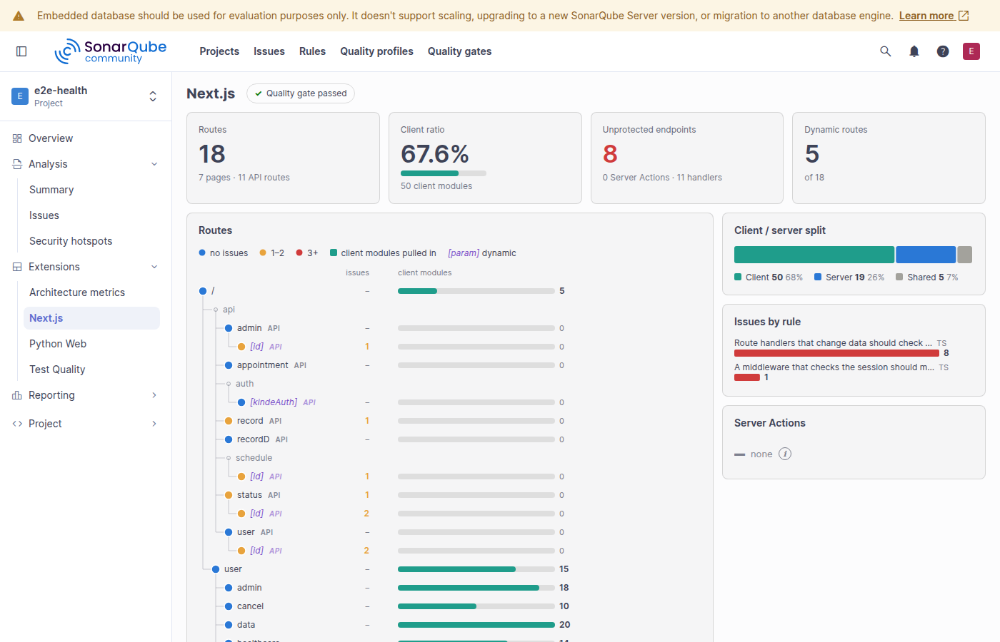

# Next.js rules for SonarQube

A SonarQube plugin that catches Next.js mistakes across the client/server boundary: secrets or server code reaching
the browser, Server Actions and route handlers open to anyone, per-user data cached for everyone, App Router APIs
misused. It builds a module graph of the app (client, server and shared modules and their imports) and checks it.

The rules were validated on public apps of different shapes, App Router and Pages Router, monorepos and apps heavy
on Server Actions (vercel/commerce, shadcn-ui/taxonomy, cal.com, dub, documenso, inbox-zero, next-learn,
saas-starter, subscription-payments and the Next.js examples): every issue reviewed and every false positive pattern
fixed, so that each rule is right in at least 9 of 10 cases. A 3700 file app scans in about 4 seconds.

## Install

Requires SonarQube Community Build 26.7 or later (tested on 26.7 with the community branch plugin, pull requests
included, and on 26.10) and Java 21.

1. Download `sonar-nextjs-<version>.jar` from the [releases](https://github.com/snake-in-prod/sonar-nextjs/releases).
2. Copy it to `extensions/plugins/` of the SonarQube server and restart.
3. Assign the "Next.js" profile, or add the rules to your own profile (see below).

The plugin analyses js and ts files of projects where a package.json declares a `next` dependency; other projects
are skipped. To build it yourself: `./mvnw verify`.

## Rules

Repositories `nextjs-js` and `nextjs-ts`, built-in profile "Next.js" for both languages. SonarQube allows one
built-in profile of a name per language, so the rules cannot join "Sonar way": activate them in your own profile, or
extend "Next.js".

| Rule | Type | Severity | In profile |
|---|---|---|---|
| ServerCodeInClientBundle | Vulnerability | Critical | yes |
| SecretInPublicEnv | Vulnerability | Critical | yes |
| ServerEnvInClient | Bug | Major | yes |
| ServerActionWithoutAuth | Vulnerability | Critical | yes |
| ServerActionWithoutValidation | Vulnerability | Major | yes |
| RouteHandlerWithoutAuth | Vulnerability | Major | yes |
| MiddlewareMatcherGap | Vulnerability | Major | yes |
| PersonalizedCachedFetch | Vulnerability | Critical | yes |
| OpenRedirect | Vulnerability | Major | yes |
| UnsafeHtmlFromInput | Vulnerability | Critical | yes |
| AsyncClientComponent | Bug | Major | yes |
| ClientHookInServerComponent | Bug | Major | yes |
| SyncParamsAccess | Bug | Major | yes |
| MetadataExportedTwice | Bug | Major | yes |
| EdgeRuntimeNodeImport | Bug | Major | yes |
| SearchParamsWithoutSuspense | Bug | Minor | no |
| ImageFillWithoutSizes | Code smell | Minor | no |

## Measures

nx_routes, nx_client_modules, nx_server_modules, nx_shared_modules, nx_client_ratio, nx_server_actions,
nx_unprotected_endpoints, nx_dynamic_routes, and nx_routes_json and nx_app_json for the project page "Next.js": the
route tree with a dot per route coloured by its issues and the client modules each pulls in, the client/server split,
issues by rule and the Server Actions. Server Actions built with next-safe-action, zsa or a project wrapper
(`withAuth(async (...) => ...)`) count; test, mock, story, end-to-end and
test fixture files are left out.
On a pull request the page shows the whole app's numbers (nx_app_json).



## Command line

```
./mvnw -q compile dependency:build-classpath -Dmdep.outputFile=cp.txt
java -cp target/classes:$(cat cp.txt) io.github.snakeinprod.nextjs.cli.Scan <app dir> [--routes] [--modules]
```

See [docs/DESIGN.md](docs/DESIGN.md) for how it works and how to write a rule.

## License

Apache-2.0
